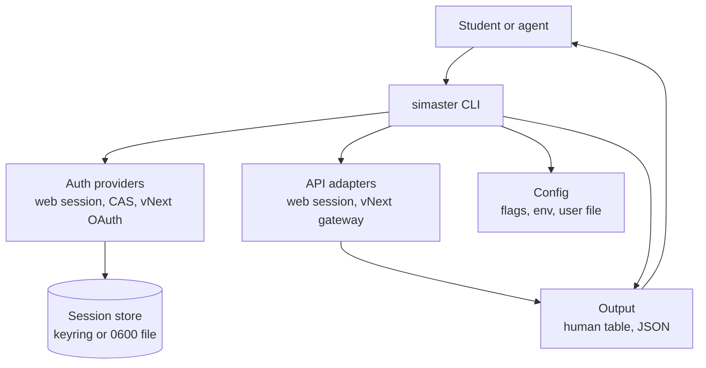
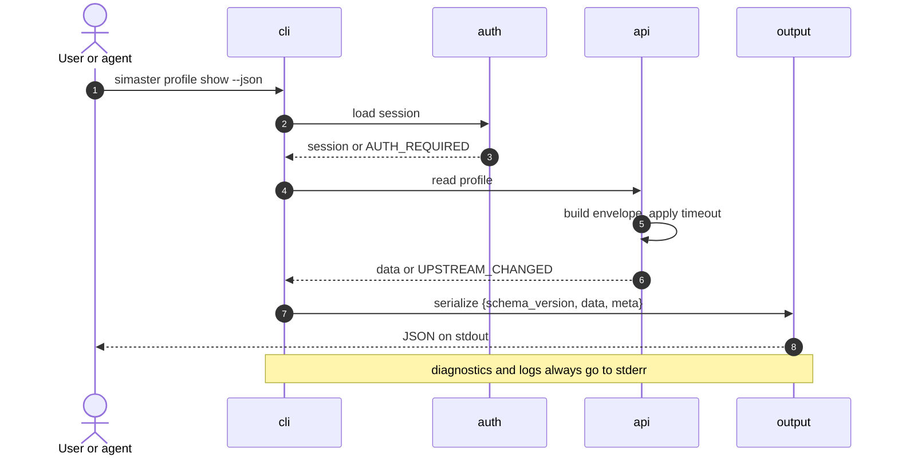

# Architecture

`simaster` is a single-binary Rust CLI with a small library core. The current
milestone (M1) contains only offline commands. Authentication and API adapters
are designed here but are not implemented yet.

## Context



The CLI is the only entry point in M1. Auth providers and API adapters will sit
behind the same dispatch layer so that commands do not talk to HTTP directly.
Structured JSON goes through the output layer. In M1, the human `doctor` text
and generated completion scripts also write to stdout directly; future human
renderers move behind the output layer. Diagnostics and logs always go to
stderr.

## Layers

| Layer | Responsibility | Current state | Planned |
|---|---|---|---|
| `cli` | Parse arguments, dispatch commands, enforce non-interactive rules. | `Cli`, `Command`, `auth`, `profile`, `doctor`, `completions`. | More nouns, confirmations, dry-run, `api`. |
| `auth` | Authentication providers, session/token lifecycle, storage. | Not implemented; auth commands return `NOT_IMPLEMENTED`. | Web session + CAS fallback (M2), vNext OAuth experimental (M2), browser SSO + PKCE (v1.0). |
| `api` | Web and vNext adapters, request envelopes, retries, contract tests. | Not implemented. | Read adapters (M3), canary and feature flags. |
| `output` | Human tables, JSON, future JSONL; redaction boundary. | `print_json` only. | Table renderer, JSONL lists, shared envelope. |
| `config` | Platform config directory, file loading, precedence. | `config_dir()` only. | `config.toml`, env overrides, validation. |
| `error` | Typed errors and exit-code mapping. | `Error` enum with a single exit code. | Stable error codes and the full mapping. |

The dependency direction is `cli -> auth/api -> output/config/error`. `auth` and
`api` must not depend on `cli`. `output` and `config` must not depend on either
network layer.

## Module map

```text
src/
├── main.rs              Process entry; maps Error to an exit code.
├── lib.rs               run(), tracing initialization, module wiring.
├── error.rs             Error enum and exit_code().
├── config.rs            config_dir().
├── output.rs            print_json().
└── cli/
    ├── mod.rs           Cli, Command, dispatch.
    ├── auth.rs          auth login|status|logout (not implemented).
    ├── profile.rs       profile show (not implemented).
    ├── doctor.rs        Offline diagnostics (implemented).
    └── completions.rs   Shell completion generation (implemented).
```

Planned additions:

```text
src/
├── auth/
│   ├── mod.rs           Provider selection and session facade.
│   ├── web.rs           SIMASTER service_login + CAS fallback.
│   ├── vnext.rs         Experimental OAuth provider.
│   └── store.rs         Keyring, 0600 file fallback, redaction.
├── api/
│   ├── mod.rs           Read-only adapter facade.
│   ├── web.rs           Web-session reads.
│   └── vnext.rs         Gateway envelope and service calls.
└── output/
    └── table.rs         TTY tables and column policies.
```

### Where to add a command

1. Add the noun/subcommand to `src/cli/mod.rs`.
2. Create or extend the subcommand module under `src/cli/`.
3. Add a handler that returns a typed `Error`; do not print errors directly.
4. Add an `assert_cmd` integration test in `tests/cli.rs` (or a new test file).
5. Update `docs/CLI-CONTRACT.md` and the command table in the README.

### Where to add an auth provider

1. Implement the provider in `src/auth/` behind the existing provider trait or
   an equivalent narrow interface. Do not add an interface with one
   implementation before the second provider exists.
2. Keep credential input out of argv. Use a prompt or stdin.
3. Store credentials through the session-store module, never in a command
   module.
4. Add a sanitized fixture and a contract test. Mark live behavior `unverified`
   until an authorized test is recorded.
5. Update `docs/AUTH.md` and the auth matrix.

### Where to add an endpoint

1. Add the adapter call under `src/api/`.
2. Add a sanitized fixture under `tests/fixtures/`.
3. Add a `wiremock` contract test once HTTP lands; the test must not contact
   production.
4. Update `docs/API-MAP.md` with the surface, method, path, auth, request,
   response, provenance, stability, live-tested status, and owner.
5. Add a feature flag or experimental status if the endpoint is not stable.

## Data flow for a read command

The following flow is the target for M3. It is not implemented in M1.



Failure paths are explicit: a missing session stops before the API call; a
timeout maps to `NETWORK`; a changed response shape maps to `UPSTREAM_CHANGED`;
a 403 maps to `PERMISSION_DENIED`. The API adapter never returns partial data
without a warning in `meta.warnings`.

## Error model and exit codes

All command handlers return `Result<(), Error>`. `src/main.rs` prints
`error: {message}` to stderr and returns `Error::exit_code()`. The M1 skeleton
maps every error to exit code 1; usage errors from clap use exit code 2.

| Condition | Error code | Exit code | M1 behavior |
|---|---|---|---|
| Success | — | 0 | Yes. |
| Generic failure or not implemented | `INTERNAL`, `NOT_IMPLEMENTED` | 1 | Yes. |
| Usage error | — | 2 | Clap default. |
| Authentication required, expired, or failed | `AUTH_REQUIRED`, `AUTH_EXPIRED`, `AUTH_FAILED` | 3 | Planned. |
| Network failure or rate limit | `NETWORK`, `RATE_LIMITED` | 4 | Planned. |
| Upstream contract changed | `UPSTREAM_CHANGED` | 5 | Planned. |
| Forbidden | `PERMISSION_DENIED` | 6 | Planned. |
| Not found | `NOT_FOUND` | 1 | Planned. |
| Configuration or IO failure | `CONFIG`, `IO` | 1 | Planned. |

The exact error-code list and the JSON error shape are in
[`CLI-CONTRACT.md`](CLI-CONTRACT.md). The mapping is a contract: changing an
exit code is a breaking change and requires an RFC.

## Output envelope

Data-bearing commands use a versioned envelope:

```json
{
  "schema_version": 1,
  "data": {},
  "meta": {
    "fetched_at": "<RFC 3339 timestamp>",
    "source": "vnext-gateway",
    "warnings": []
  }
}
```

`meta.fetched_at` is omitted or `null` for data that was not fetched.
`meta.source` names the adapter. `meta.warnings` is present even when empty, so
agents can rely on the key.

`doctor --json` is a local diagnostic, not a fetched resource. It uses
`schema_version: 1`, `data`, and `meta.generated_at_unix`, as implemented. This
is the only current exception; new data commands use the full envelope.

`print_json` writes pretty-printed JSON plus a trailing newline to stdout. The
human renderer is planned; until it exists, only `doctor` has human output.

## Configuration and storage

Precedence, highest first:

1. Command-line flags.
2. Environment variables with the `SIMASTER_` prefix (plus `RUST_LOG`,
   `NO_COLOR`, and `RUST_BACKTRACE` where relevant).
3. The user configuration file in the platform config directory.
4. Built-in defaults.

There is no project-local configuration and no project-local secret file. A
repository checkout must never supply credentials.

The platform config directory is produced by `directories::ProjectDirs` with
qualifier `id`, organization `ugm`, and application `simaster`. `simaster
doctor` reports the resolved path. The directory is not created in M1.

Planned storage:

- **Session cookie:** operating-system keyring first.
- **OAuth tokens:** keyring first; refresh token and expiry stored together.
- **File fallback:** `0600` on Unix and a restricted ACL on Windows, with an
  explicit warning in `doctor`.
- **Logout:** removes the keyring entry and the fallback file; a partial failure
  is reported, never silently ignored.

## Testing strategy

| Layer | Tool | Scope |
|---|---|---|
| Unit | `cargo test` | Pure functions, error mapping, config precedence, redaction. |
| CLI integration | `assert_cmd` + `predicates` | Command wiring, help, exit codes, stdout/stderr separation. |
| Snapshot | `trycmd` (planned) | Stable help text and JSON examples. |
| HTTP contract | `wiremock` (planned) | Adapter behavior against sanitized fixtures. |
| Fixtures | `tests/fixtures/` (planned) | Sanitized request/response pairs; no production data. |
| Canary | Scheduled job (planned) | Opt-in, maintainer's own account, fails with `UPSTREAM_CHANGED`. |

Current tests are in `tests/cli.rs` and cover the M1 contract: help lists the
nouns, `doctor --json` has the expected envelope, `auth login` reports not
implemented, and bash completions are generated. PR CI never contacts SIMASTER.
The canary is never a required PR check.

## Logging and redaction

- Logs and diagnostics go to stderr; stdout is reserved for command output.
- `--verbose` sets the default filter to `debug`; otherwise it is `warn`.
- `RUST_LOG` overrides both.
- `tracing` is the only logging facade. Do not use `println!` for diagnostics.
- Redact passwords, cookies, access tokens, refresh tokens, authorization codes,
  client secrets, and full request bodies before any log, error, or crash
  report.
- Do not log usernames or student identifiers at `info` or above.
- `NO_COLOR` is honored by future human renderers; JSON output never contains
  ANSI escapes.

## MCP boundary

A read-only MCP server is planned for M4. It will be a **separate process**
(`simaster-mcp`) that reuses the library crate, not a subcommand of the
single-binary CLI.

Reasons:

- MCP uses a long-running stdio protocol; the CLI is one-shot.
- A protocol failure must not affect normal CLI use, and vice versa.
- The server can be sandboxed and run with a narrower permission set.
- The CLI can keep a small dependency surface; MCP transport dependencies stay
  out of the default binary.
- The shared library is the contract boundary. The MCP server must call the same
  adapters and output the same envelope, not a second implementation.

The MCP server will be read-only in M4. Write tools require the M5 safeguards
and an explicit `--allow-write` equivalent.

## Decisions

- [ADR 0001: single crate](adr/0001-single-crate.md)
- [ADR 0002: authentication strategy](adr/0002-auth-strategy.md)
