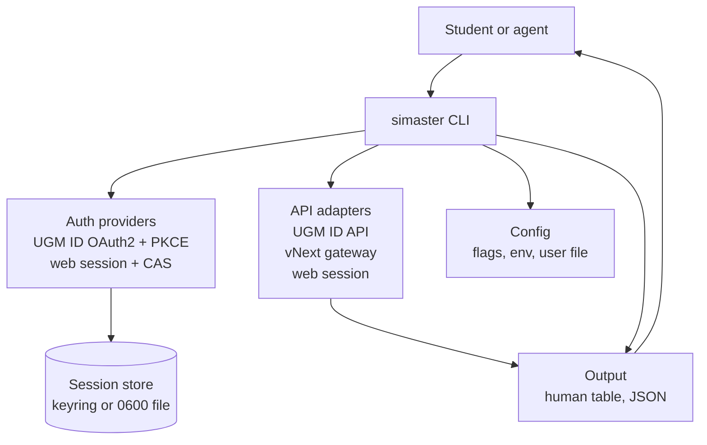
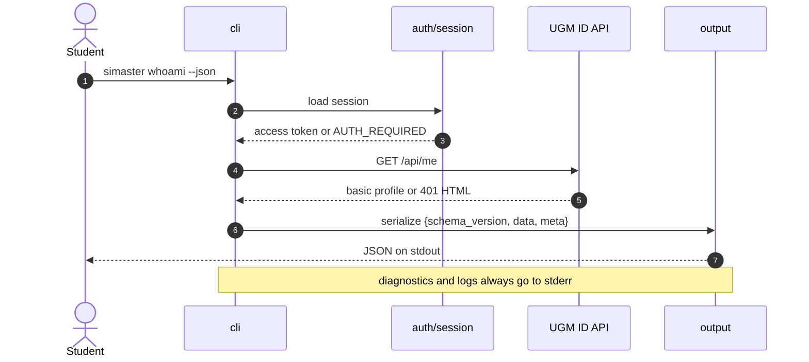
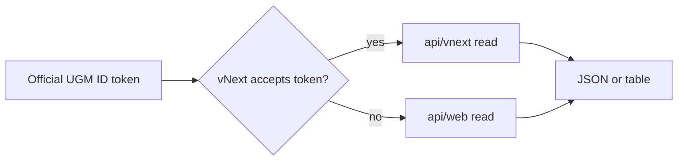

# Architecture

`simaster` is a single-binary Rust CLI with a small library core. The current
milestone (M1) contains only offline commands. The M2 authentication and profile
path is designed here but is not implemented yet.

## Context



The CLI is the only entry point in M1. Auth providers and API adapters sit behind
the same dispatch layer so commands do not talk to HTTP directly. Structured
JSON goes through the output layer. In M1, the human `doctor` text and generated
completion scripts also write to stdout directly; future human renderers move
behind the output layer. Diagnostics and logs always go to stderr.

The official UGM ID OAuth2/OIDC API is the primary authentication and identity
surface. The UGM ID resource API supplies the basic and full profile. The vNext
gateway and the web session are **data adapters**; the vNext gateway is not an
authentication provider.

## Layers

| Layer | Responsibility | Current state | Planned |
|---|---|---|---|
| `cli` | Parse arguments, dispatch commands, enforce non-interactive rules. | `Cli`, `Command`, `auth`, `profile`, `doctor`, `completions`. | `whoami`, more nouns, confirmations, dry-run, `api`. |
| `auth` | Authentication providers, OIDC validation, session lifecycle, storage. | Not implemented; auth commands return `NOT_IMPLEMENTED`. | `auth/oauth` (PKCE, loopback, token exchange), `auth/oidc` (discovery, JWKS, ID-token validation), `auth/web` (fallback), `auth/session` (keyring). |
| `api` | Adapters for UGM ID resources, vNext, and the web session; retries; contract tests. | Not implemented. | `api/ugm_id`, `api/vnext`, `api/web` (M2/M3). |
| `output` | Human tables, JSON, future JSONL; redaction boundary. | `print_json` only. | Table renderer, JSONL lists, shared envelope. |
| `config` | Platform config directory, file loading, precedence. | `config_dir()` only. | `config.toml`, env overrides, validation. |
| `error` | Typed errors and exit-code mapping. | `Error` enum with a single exit code. | Stable error codes and the full mapping. |

The dependency direction is `cli -> auth/api -> output/config/error`. `auth` and
`api` must not depend on `cli`. `output` and `config` must not depend on either
network layer.

## Module map

```text
src/
├── main.rs              Process entry; maps Error to an exit code.
├── lib.rs               run(), tracing initialization, module wiring.
├── error.rs             Error enum and exit_code().
├── config.rs            config_dir().
├── output.rs            print_json().
└── cli/
    ├── mod.rs           Cli, Command, dispatch.
    ├── auth.rs          auth login|status|logout (not implemented).
    ├── profile.rs       profile show (not implemented).
    ├── doctor.rs        Offline diagnostics (implemented).
    └── completions.rs   Shell completion generation (implemented).
```

Planned additions:

```text
src/
├── auth/
│   ├── mod.rs           Provider selection: auto, browser, web, sso.
│   ├── oauth.rs         Authorization URL, PKCE, loopback listener, code exchange.
│   ├── oidc.rs          Discovery, JWKS cache, ID-token validation.
│   ├── web.rs           SIMASTER service_login + CAS fallback.
│   └── session.rs       Keyring, 0600 file fallback, redaction, logout.
├── api/
│   ├── mod.rs           Read-only adapter facade.
│   ├── ugm_id.rs        /api/me, /user/me, /userinfo.
│   ├── vnext.rs         Gateway envelope and service calls.
│   └── web.rs           Web-session reads.
└── output/
    └── table.rs         TTY tables and column policies.
```

### Where to add a command

1. Add the noun/subcommand to `src/cli/mod.rs`.
2. Create or extend the subcommand module under `src/cli/`.
3. Add a handler that returns a typed `Error`; do not print errors directly.
4. Add an `assert_cmd` integration test in `tests/cli.rs` (or a new test file).
5. Update `docs/CLI-CONTRACT.md` and the command table in the README.

### Where to add an auth provider

1. Implement the provider in `src/auth/` behind the existing provider selection.
2. Keep credential input out of argv. Browser PKCE never handles a password; the
   web fallback prompts or reads stdin.
3. Store tokens and cookies through `auth/session`, never in a command module.
4. Add mocked discovery/token/JWKS/user tests. Mark live behavior `unverified`
   until an authorized test is recorded.
5. Update [`AUTH.md`](AUTH.md), [`UGM-ID-API.md`](UGM-ID-API.md), and the auth
   matrix.

### Where to add an endpoint

1. Add the adapter call under `src/api/`.
2. Add a sanitized fixture under `tests/fixtures/`.
3. Add a `wiremock` contract test once HTTP lands; the test must not contact
   production.
4. Update [`API-MAP.md`](API-MAP.md) with the level, surface, method, path, auth,
   request, response, provenance, stability, live-tested status, and owner.
5. Use the official UGM ID documentation as primary evidence. Prior-art static
   analysis is secondary and must be labelled as such.

## Data flow for `whoami` and `profile show`

The following flow is the target for M2. It is not implemented in M1.



`profile show` uses the same path with `GET /user/me` and the
`userDetail.read` scope. A missing session stops before the API call. A 401 with
an HTML body maps to `AUTH_REQUIRED` or `AUTH_EXPIRED`, never to a JSON parse
error. A 403 maps to `PERMISSION_DENIED`. A changed response shape maps to
`UPSTREAM_CHANGED`.

The data adapter fallback for M3 is:



Token acceptance is `unverified` until an authorized M3 test. The project never
adds a mobile-client auth provider or an embedded secret to make the gateway
work.

## Error model and exit codes

All command handlers return `Result<(), Error>`. `src/main.rs` prints
`error: {message}` to stderr and returns `Error::exit_code()`. The M1 skeleton
maps every error to exit code 1; usage errors from clap use exit code 2.

| Condition | Error code | Exit code | M1 behavior |
|---|---|---|---|
| Success | — | 0 | Yes. |
| Generic failure or not implemented | `INTERNAL`, `NOT_IMPLEMENTED` | 1 | Yes. |
| Usage error | — | 2 | Clap default. |
| Authentication required, expired, or failed | `AUTH_REQUIRED`, `AUTH_EXPIRED`, `AUTH_FAILED` | 3 | Planned. |
| Network failure or rate limit | `NETWORK`, `RATE_LIMITED` | 4 | Planned. |
| Upstream contract changed | `UPSTREAM_CHANGED` | 5 | Planned. |
| Forbidden | `PERMISSION_DENIED` | 6 | Planned. |
| Not found | `NOT_FOUND` | 1 | Planned. |
| Configuration or IO failure | `CONFIG`, `IO` | 1 | Planned. |

`UPSTREAM_CHANGED` covers a missing field, an unexpected status, a metadata
mismatch, or a discovery issuer that does not match the literal published
value. The exact error-code list and JSON error shape are in
[`CLI-CONTRACT.md`](CLI-CONTRACT.md).

## Output envelope

Data-bearing commands use a versioned envelope:

```json
{
  "schema_version": 1,
  "data": {},
  "meta": {
    "fetched_at": "<RFC 3339 timestamp>",
    "source": "ugm-id",
    "warnings": []
  }
}
```

`meta.fetched_at` is omitted or `null` for data that was not fetched.
`meta.source` names the adapter (`ugm-id`, `vnext-gateway`, `web`, or `local`).
`meta.warnings` is present even when empty, so agents can rely on the key.

`doctor --json` is a local diagnostic, not a fetched resource. It uses
`schema_version: 1`, `data`, and `meta.generated_at_unix`, as implemented. This
is the only current exception; new data commands use the full envelope.

## Configuration and storage

Precedence, highest first:

1. Command-line flags.
2. Environment variables with the `SIMASTER_` prefix (plus `RUST_LOG`,
   `NO_COLOR`, and `RUST_BACKTRACE` where relevant).
3. The user configuration file in the platform config directory.
4. Built-in defaults.

There is no project-local configuration and no project-local secret file. A
repository checkout must never supply credentials.

The platform config directory is produced by `directories::ProjectDirs` with
qualifier `id`, organization `ugm`, and application `simaster`. `simaster
doctor` reports the resolved path. The directory is not created in M1.

Planned storage:

- **UGM ID tokens:** access, refresh, and ID token in the operating-system
  keyring first.
- **Web session cookie:** keyring first.
- **File fallback:** `0600` on Unix and a restricted ACL on Windows, with an
  explicit warning in `doctor` and `auth status`.
- **Logout:** removes the keyring entry and the fallback file; a partial failure
  is reported, never silently ignored.
- **Passwords:** never stored. Browser PKCE does not see the password; the web
  fallback only holds it for the duration of the request.

## M2 dependencies to plan

Do not add these to the M1 skeleton. The M2 implementation will need:

- a local HTTP listener bound to `127.0.0.1` for the one-shot loopback callback;
- a browser opener with a `--no-browser` URL fallback;
- SHA-256, base64url, and a cryptographically secure random source for PKCE,
  `state`, and `nonce`;
- JWT parsing and JWKS/RS256 validation for the ID token;
- an OS keyring integration with a `0600` file fallback;
- a bounded HTTP client with timeout, `Retry-After`, and redacted errors.

The listener, opener, PKCE, JWT, keyring, and HTTP client are M2 capabilities, not
M1 dependencies. No dependency is added in this revision.

## Testing strategy

| Layer | Tool | Scope |
|---|---|---|
| Unit | `cargo test` | PKCE derivation, state/nonce comparison, ID-token claims, error mapping, config precedence, redaction. |
| CLI integration | `assert_cmd` + `predicates` | Command wiring, help, exit codes, stdout/stderr separation. |
| Snapshot | `trycmd` (planned) | Stable help text and JSON examples. |
| HTTP contract | `wiremock` (planned) | Mocked discovery, token, JWKS, and user endpoints; no production. |
| Loopback | unit/integration (planned) | One-shot listener, timeout, wrong path, repeated callback, state mismatch. |
| Fixtures | `tests/fixtures/` (planned) | Sanitized request/response pairs; no production data. |
| Canary | Scheduled job (planned) | Opt-in, maintainer's own account, read-only, fails with `UPSTREAM_CHANGED`. |

Current tests are in `tests/cli.rs` and cover the M1 contract: help lists the
nouns, `doctor --json` has the expected envelope, `auth login` reports not
implemented, `auth login --help` exposes `auto|browser|web|sso` and no `vnext`,
and bash completions are generated. PR CI never contacts SIMASTER or UGM ID. The
canary is never a required PR check.

## Logging and redaction

- Logs and diagnostics go to stderr; stdout is reserved for command output.
- `--verbose` sets the default filter to `debug`; otherwise it is `warn`.
- `RUST_LOG` overrides both.
- `tracing` is the only logging facade. Do not use `println!` for diagnostics.
- Redact passwords, cookies, access tokens, refresh tokens, ID tokens,
  authorization codes, PKCE verifiers, client secrets, and full callback URLs
  before any log, error, or crash report.
- Do not log usernames or student identifiers at `info` or above.
- `NO_COLOR` is honored by future human renderers; JSON output never contains
  ANSI escapes.

## MCP boundary

A read-only MCP server is planned for M4. It will be a **separate process**
(`simaster-mcp`) that reuses the library crate, not a subcommand of the
single-binary CLI.

Reasons:

- MCP uses a long-running stdio protocol; the CLI is one-shot.
- A protocol failure must not affect normal CLI use, and vice versa.
- The server can be sandboxed and run with a narrower permission set.
- The CLI can keep a small dependency surface; MCP transport dependencies stay
  out of the default binary.
- The shared library is the contract boundary. The MCP server must call the same
  adapters and output the same envelope, not a second implementation.

The MCP server will be read-only in M4. Browser authentication remains a human
action; an MCP tool must not automate consent or scrape tokens. Write tools
require the M5 safeguards and an explicit `--allow-write` equivalent.

## Decisions

- [ADR 0001: single crate](adr/0001-single-crate.md)
- [ADR 0002: authentication strategy](adr/0002-auth-strategy.md)
