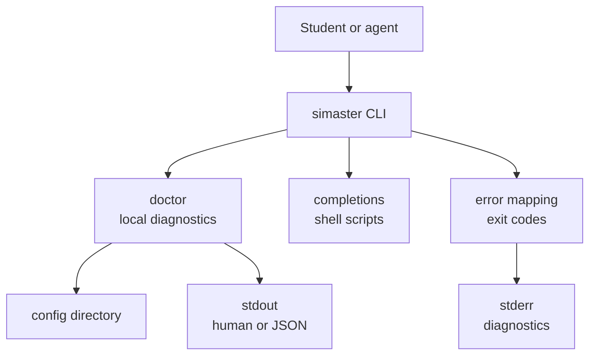

# Architecture

`simaster` is a single-binary Rust CLI with a small library core. Offline diagnostics and shell completions are implemented; authentication and API adapters are not.

## Context



The CLI is the only entry point. Structured JSON goes through the output layer; diagnostics and logs go to stderr. No network surface exists yet.

## Layers

| Layer | Current state |
|---|---|
| `cli` | `Cli`, `Command`, `auth`, `profile`, `doctor`, `completions`; `auth` and `profile` return `NOT_IMPLEMENTED`. |
| `output` | `print_json` only; human renderers are still inline. |
| `config` | `config_dir()` only; the directory is reported, not created. |
| `error` | `Error` enum; `exit_code()` returns 1; clap returns 2 for usage errors. |
| `auth` / `api` | Not implemented; the design and endpoint evidence are in [`AUTH.md`](AUTH.md). |

Dependency direction: `cli -> auth/api -> output/config/error`. `auth` and `api` must not depend on `cli`; `output` and `config` must not depend on a network layer.

## Module map

```text
src/
├── main.rs              Process entry; maps Error to an exit code.
├── lib.rs               run(), tracing initialization, module wiring.
├── error.rs             Error enum and exit_code().
├── config.rs            config_dir().
├── output.rs            print_json().
└── cli/
    ├── mod.rs           Cli, Command, dispatch.
    ├── auth.rs          auth login|status|logout (not implemented).
    ├── profile.rs       profile show (not implemented).
    ├── doctor.rs        Offline diagnostics (implemented).
    └── completions.rs   Shell completion generation (implemented).
```

## Current command flow

`doctor` resolves the config directory with `directories::ProjectDirs` (qualifier `id`, organization `ugm`, application `simaster`), runs local checks only, and writes human text or JSON to stdout. It never contacts a network. `completions <shell>` generates a script from the live clap tree with `clap_complete`. Both return `Result<(), Error>`; `main.rs` prints `error: {message}` to stderr and returns the mapped exit code. Handlers do not print their own errors.

## Where to add work

**Command.** Add the noun/subcommand to `src/cli/mod.rs`, create or extend the module, return a typed `Error`, add an `assert_cmd` test, and update [`CLI-CONTRACT.md`](CLI-CONTRACT.md) and the README table.

**Auth provider.** Implement it under `src/auth/` behind the provider selection. Keep credentials out of argv: browser PKCE never handles a password; the web fallback prompts or reads stdin. Store tokens and cookies through the session layer, never a command module. Add mocked discovery/token/JWKS/user tests and mark live behavior `unverified` until an authorized test is recorded. Update [`AUTH.md`](AUTH.md).

**Endpoint.** Add the adapter under `src/api/`, a sanitized fixture under `tests/fixtures/`, and a mocked contract test that cannot contact production. Record provenance, stability, and live-tested status in [`AUTH.md`](AUTH.md) or the relevant GitHub issue. Official UGM ID documentation is primary; prior-art static analysis is secondary.

## Error model and exit codes

All handlers return `Result<(), Error>`. The skeleton maps every typed error to exit 1; clap uses 2. Codes 3-6 are the contract for the auth and network paths when they exist.

| Condition | Error code | Exit code |
|---|---|---:|
| Success | — | 0 |
| Generic failure or not implemented | `INTERNAL`, `NOT_IMPLEMENTED` | 1 |
| Usage error | — | 2 |
| Authentication required, expired, or failed | `AUTH_REQUIRED`, `AUTH_EXPIRED`, `AUTH_FAILED` | 3 |
| Network failure or rate limit | `NETWORK`, `RATE_LIMITED` | 4 |
| Upstream contract changed | `UPSTREAM_CHANGED` | 5 |
| Forbidden | `PERMISSION_DENIED` | 6 |

`UPSTREAM_CHANGED` covers a missing field, unexpected status, metadata mismatch, or a discovery issuer that does not match the literal published value. The full list is in [`CLI-CONTRACT.md`](CLI-CONTRACT.md).

## Output envelope

```json
{
  "schema_version": 1,
  "data": {},
  "meta": {
    "fetched_at": "<RFC 3339 timestamp>",
    "source": "ugm-id",
    "warnings": []
  }
}
```

`meta.fetched_at` is `null` when no fetch occurred; `meta.source` is `ugm-id`, `vnext-gateway`, `web`, or `local`; `meta.warnings` is always present. `doctor --json` is the current exception: a local diagnostic with `data` and `meta.generated_at_unix`.

## Configuration and storage

Precedence, highest first: command-line flags; `SIMASTER_*` environment variables plus `RUST_LOG`, `NO_COLOR`, and `RUST_BACKTRACE` where relevant; the user config file in the platform config directory; built-in defaults. There is no project-local configuration or secret file. Credential storage is not implemented; the design is keyring-first with a `0600` file fallback (restricted ACL on Windows), no password storage, and logout that removes local state and reports partial failure.

## Testing and redaction

The suite is offline. `tests/cli.rs` covers command listing, the `doctor --json` envelope, `auth login` returning not implemented, the `auto|browser|web|sso` method set without `vnext`, and bash completion generation. PR CI never contacts SIMASTER or UGM ID. Unit tests live beside the code; integration tests use `assert_cmd` and `predicates`; sanitized fixtures belong under `tests/fixtures/`. A scheduled canary, when present, is not a PR check.

Logs go to stderr; stdout is reserved for output. `--verbose` sets `debug`, otherwise `warn`; `RUST_LOG` overrides both. `tracing` is the only logging facade. Redact passwords, cookies, tokens, authorization codes, PKCE verifiers, client secrets, and full callback URLs before any log, error, or crash report. Do not log usernames or student identifiers at `info` or above. JSON never contains ANSI escapes.

## Decisions

- [ADR 0001: single crate](adr/0001-single-crate.md)
- [ADR 0002: authentication strategy](adr/0002-auth-strategy.md)
- A read-only `api` escape hatch and MCP server are tracked in [#43](https://github.com/pendopo-dev/simaster/issues/43).
