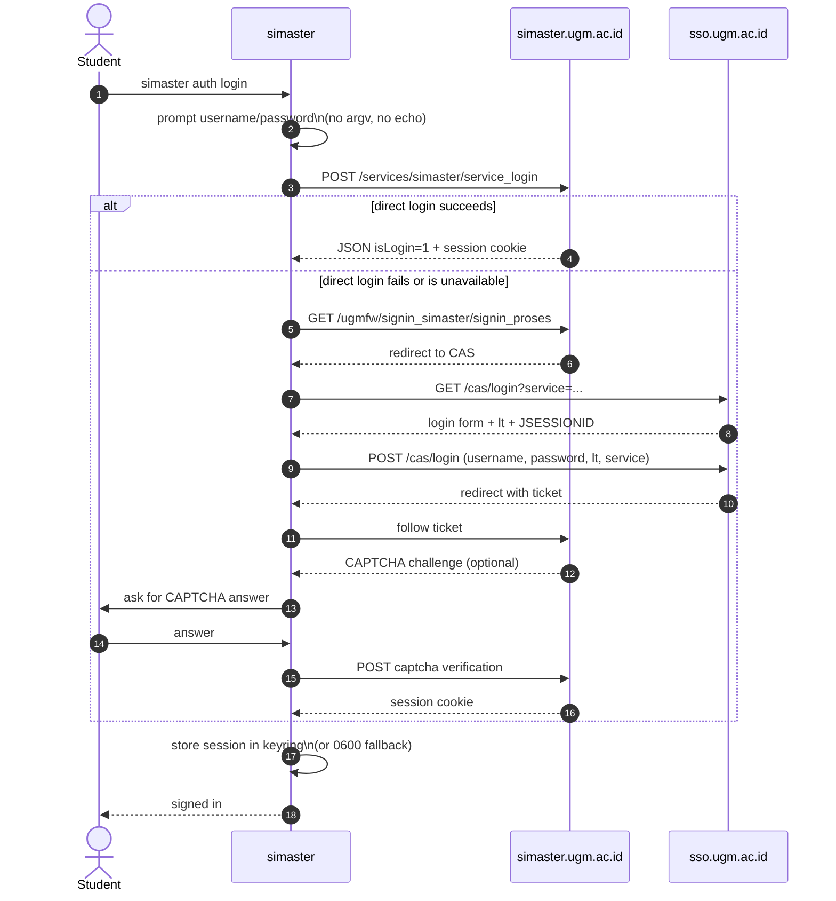
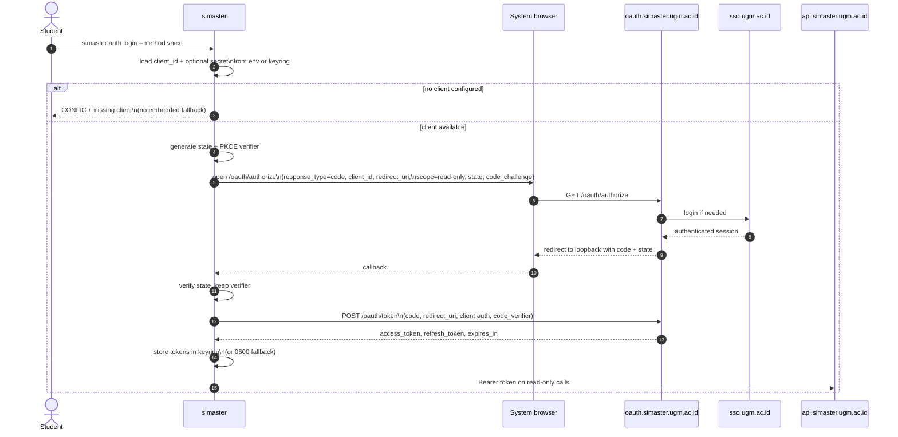

# Authentication

This document describes the authentication options, the chosen defaults, the
evidence behind each endpoint, and the security rules the implementation must
follow. All upstream behavior is **unverified**: the evidence is prior-art code
and static analysis, not a live test. Do not treat an endpoint description as a
server contract.

## Decision

1. **Default:** the SIMASTER web session flow with a CAS fallback.
2. **Experimental:** the official app's vNext OAuth provider, opt-in, using a
   user-supplied authorized client. The app's embedded client secret and client
   ID are never copied, bundled, or published as values.
3. **Target for v1.0:** browser SSO with PKCE, `state`, and a loopback redirect.
   It is blocked until a client is registered for this use case.
4. **Non-negotiable:** no password in argv, no secrets in logs, no multi-user
   token reuse, and no bypass of CAPTCHA, MFA, rate limits, or authorization.

The rationale is recorded in
[ADR 0002](adr/0002-auth-strategy.md).

## Options

| Method | How it works | Pros | Cons | Status |
|---|---|---|---|---|
| **Web session** | `POST /services/simaster/service_login` with username and password; store the session cookie. | Simplest flow; matches the portal; works with a student account. | Cookie expiry; CAPTCHA or MFA can interrupt; HTML/JSON shape can change; password handling. | Default, planned M2. |
| **CAS fallback** | Redirect through `sso.ugm.ac.id/cas/login?service=...`, submit the login form with `lt`, follow the ticket, handle CAPTCHA. | Reuses the same credentials; survives a broken direct login; matches normal SSO. | HTML parsing; CAPTCHA; redirect chain can change; still a password flow. | Automatic fallback, planned M2. |
| **vNext OAuth** | Authorization-code flow through `oauth.simaster.ugm.ac.id`; use access and refresh tokens against the gateway. | Token lifecycle; refresh; no cookie jar. | Official app uses an embedded secret, a custom scheme, and no PKCE/state; not usable by this CLI as-is. A user must supply an authorized client. | Experimental, opt-in, planned M2. |
| **Browser SSO + PKCE** | Open the system browser; authorize with `state` + PKCE; receive the code on a loopback redirect; exchange it for tokens. | No password in the CLI; MFA-friendly; best practice for native apps. | Requires a registered client and an allowed loopback redirect; not available today. | Blocked, target v1.0. |
| **Cookie import** | Read a user-supplied cookie jar for an existing session. | Avoids a password prompt; useful when login is interactive. | A cookie is a bearer credential; expiry and leakage risk; UX and storage burden. | Candidate, not scheduled. |

## Web session and CAS fallback

The default `auth login` flow tries the web session endpoint first. If it does
not produce a valid session, the CLI falls back to the CAS login page.



All steps are `unverified`; they are reconstructed from prior-art code. The
CLI does not solve CAPTCHAs automatically and does not bypass MFA. If the
challenge cannot be completed interactively, auth fails with `AUTH_FAILED` and
a message that points to the browser as the fallback.

The direct flow sends form fields `aId`, `username`, and `password` to the
service login endpoint. The response is read as JSON with `isLogin` and
`namaLengkap`. The fallback extracts the CAS `lt` token and `JSESSIONID`, then
posts `username`, `password`, `lt`, `_eventId=submit`, and `submit=LOGIN`.

## vNext OAuth (experimental)

The vNext provider is opt-in with `--method vnext`. It is intended for users
who have an authorized OAuth client they are allowed to use. The project ships
no client credential.



The official app's flow differs in ways this project does not copy: it has no
`state`, no PKCE, uses the app's custom scheme
`id.ac.ugm.student.vnext.simaster://oauth2`, and embeds a client secret in the
binary. That custom scheme belongs to the official app and is **not usable by
this CLI**. The CLI uses a loopback redirect and PKCE when a registered client
is available.

`state` is compared exactly and discarded after use. The authorization code is
single-use and never printed. The token request uses the user's client
credentials from the environment or keyring; the secret is never written to
disk in plaintext.

## Endpoint evidence

Every row below is `unverified`. Provenance is prior-art code or static
analysis of the official app, not a live request. See
[`API-MAP.md`](API-MAP.md) for the full registry and stability policy.

| Endpoint | Method | Purpose | Evidence | Status |
|---|---|---|---|---|
| `https://simaster.ugm.ac.id/services/simaster/service_login` | `POST` | Direct web session login. | Prior-art `simaster.py`. Request fields `aId`, `username`, `password`; response JSON `isLogin`, `namaLengkap`. | `unverified` |
| `https://sso.ugm.ac.id/cas/login?service=...` | `GET` | CAS login page; provides `lt` and `JSESSIONID`. | Prior-art `simaster.py`, `oauth.py`. | `unverified` |
| `https://simaster.ugm.ac.id/ugmfw/signin_simaster/signin_proses` | `GET` | Starts the CAS redirect chain. | Prior-art `simaster.py`. | `unverified` |
| `https://simaster.ugm.ac.id/ugmfw/signin_simaster/captchasound_verification` | `POST` | Submits an interactive CAPTCHA answer. | Prior-art `simaster.py`; exact form contract not verified. | `unverified` |
| `https://oauth.simaster.ugm.ac.id/oauth/authorize` | `GET` | vNext authorization request. | Static analysis; the official app sends no `state`/PKCE. | `unverified` |
| `https://oauth.simaster.ugm.ac.id/oauth/token` | `POST` | vNext code exchange and refresh. | Static analysis; exact grant and error shapes not verified. | `unverified` |
| `https://api.simaster.ugm.ac.id/v1/student/micro/services` | `POST` | Student data gateway. | Static analysis of the official app. | `unverified` |

Never send credentials to a host that is not one of the documented HTTPS
endpoints. Certificate validation is always on; cleartext HTTP is never used.

## Least-privilege scopes

The production app requests twelve scopes, four of which grant write access.
This project requests only the read-only subset it needs:

```text
user.read
userDetail.read
student
student.read
student.niu.read
vehicle.read
parent.read
transgama.read
```

Never request these write scopes by default:

```text
user.read-write-update
mygate.read-write
parent.read-write-update
student.read-write-update
```

A future write feature must request its narrowest scope, require an RFC, and
ship behind `--allow-write` with a dry run. Scope presence is not proof of
server authorization; scope enforcement is `unverified`.

## Secret policy

- The official mobile app's `client_id`, `client_secret`, redirect URI as a
  usable credential, and any extracted token are out of scope. Only the custom
  scheme is documented, and only to explain why this CLI cannot use it.
- The vNext provider takes a user-supplied client through
  `SIMASTER_CLIENT_ID` and, for a confidential client, `SIMASTER_CLIENT_SECRET`
  from the environment or keyring. An empty value is an error, not a reason to
  fall back to a bundled secret.
- The browser SSO target uses PKCE and a loopback redirect; it does not need a
  client secret.
- Tokens are bearer credentials. They are never passed in a URL, written to a
  log, or included in a crash report.
- Placeholders in documentation use `<client-id>`, `<client-secret>`, and
  `<token>`. A real value is never committed.

## Session and token storage

| Item | Storage | Lifetime | Removal |
|---|---|---|---|
| Web session cookie | OS keyring first; `0600` file fallback. | Until expiry or a 401/redirect-to-login. | `auth logout`; overwrite on next login. |
| vNext access token | OS keyring first; `0600` fallback. | `expires_in` minus a safety margin. | Refresh, logout, or `AUTH_EXPIRED`. |
| vNext refresh token | Same entry as the access token. | Until rejected by the token endpoint. | Logout; local deletion even if revocation is unavailable. |
| Client secret | Environment or keyring; never the config file by default. | User-managed. | User removes it. |

The file fallback is created with mode `0600` on Unix and a restricted ACL on
Windows. The file contains only the minimum fields and is never stored in the
repository or a project directory. `doctor` reports which storage is in use and
warns if the fallback is active.

Expiry handling:

- A response that redirects to login or returns 401 invalidates the web session.
  The CLI reports `AUTH_EXPIRED` and asks the user to log in again.
- The vNext provider refreshes before the access token expires. A failed refresh
  maps to `AUTH_EXPIRED`; it never retries with a stale token.
- A 403 maps to `PERMISSION_DENIED`, not to a silent retry.
- Logout removes local state even if a revocation call fails. It reports the
  partial failure, because a token that could not be revoked is a risk the user
  must know about.

## Failure modes

| Failure | Detection | User-visible result | Mitigation |
|---|---|---|---|
| Wrong username or password | Login response is not authenticated. | `AUTH_FAILED`, no retry loop. | Prompt again only on explicit user action. |
| CAPTCHA | Challenge page in the fallback chain. | Interactive prompt. | User answers; no OCR service; browser fallback. |
| MFA | SSO page asks for a second factor. | `AUTH_FAILED` with a browser hint. | Browser SSO is the long-term fix. |
| Rate limit | HTTP 429 or a documented retry signal. | `RATE_LIMITED`, exit 4. | Honor `Retry-After`; no aggressive retry. |
| Expired session | 401 or redirect to login. | `AUTH_EXPIRED`, exit 3. | Re-authenticate. |
| WAF or bot challenge | Non-JSON HTML, 403, or an unexpected challenge. | `PERMISSION_DENIED` or `UPSTREAM_CHANGED` with a browser hint. | Stop; do not evade. |
| Upstream shape change | Missing JSON field or unexpected status. | `UPSTREAM_CHANGED`, exit 5. | Fixture update, canary, feature flag. |
| Missing vNext client | No client ID configured. | `CONFIG`, exit 1. | Explain how to supply an authorized client; never embed one. |
| Network failure | Timeout or connection error. | `NETWORK`, exit 4. | Bounded retry with backoff for idempotent reads. |
| Account inactive | Documented response field. | `AUTH_FAILED` with the upstream message, redacted. | No workaround. |

## Threat model

| Asset | Adversary | Mitigation |
|---|---|---|
| UGM password | Local malware, shoulder surfing, shell history, process list. | Prompt or stdin, no argv, no environment variable by default, no echo. |
| Session cookie | Local file reader, log collector, backup. | Keyring first, `0600` fallback, no logs, logout deletes it. |
| OAuth access/refresh token | Local file reader, log collector, crash reporter. | Keyring first, redaction, no token in URL or error, refresh rotation when supported. |
| Authorization code | Another local app, redirect interception. | `state` + PKCE, loopback redirect, single-use code, never printed. |
| Student data | Another user, a malicious agent, a shared terminal. | Own-account use, read-only default, no multi-user tokens, no caching of sensitive data by default. |
| Build and release artifacts | Supply-chain attacker. | Locked dependencies, cargo-deny, Dependabot, signed tags, review of workflow changes. |

The CLI does not defend against a compromised operating system or a user who
shares their own credentials. It does defend against accidental disclosure in
its own output and logs.

## Responsible use

- Use only your own account and your own data.
- Do not share, pool, sell, or reuse sessions or tokens across users.
- Do not use the CLI to access another person's records, even if an endpoint
  appears to allow it.
- Do not bypass CAPTCHA, MFA, rate limits, or authorization.
- Do not run load tests or scans against UGM systems.
- Follow UGM policy and applicable law. If a feature is not permitted, do not
  add it.
- Report upstream vulnerabilities to UGM, not in this project's public issue
  tracker.

## Revisit triggers

Review this decision when:

- UGM registers an OAuth client for CLI or native use, or publishes a supported
  API;
- UGM makes MFA mandatory for all students;
- the web session or CAS flow breaks in a way that cannot be fixed without a
  browser;
- the OAuth server requires PKCE or changes its redirect policy;
- token lifetimes or refresh behavior change;
- a security review finds credential handling below the standard in this
  document.

The review is an RFC under [`GOVERNANCE.md`](../GOVERNANCE.md) if it changes the
default method, the storage model, or the scope policy.
