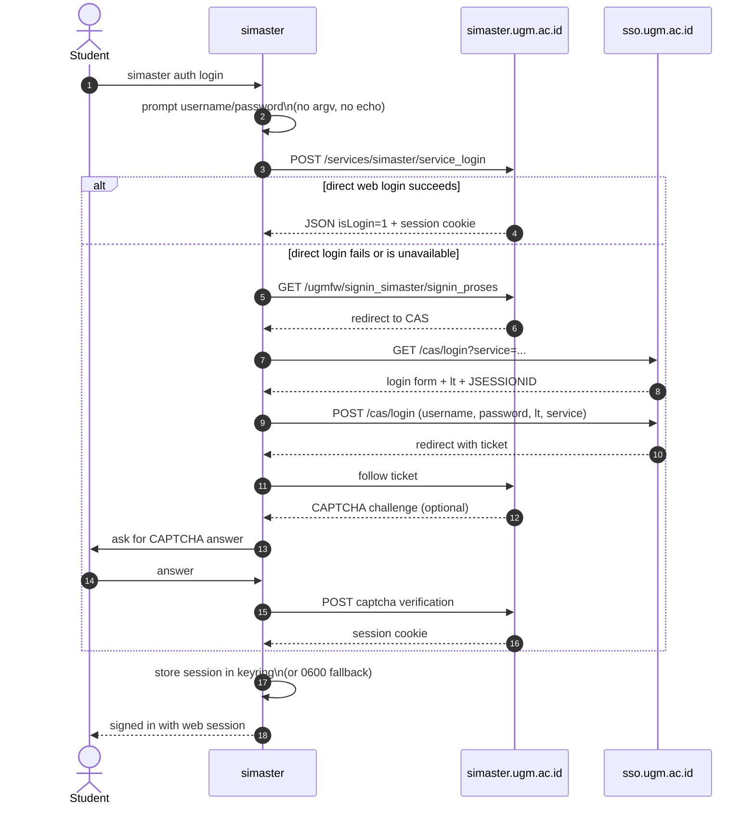

# Authentication

This document describes the authentication decision, the browser PKCE flow, the
web session fallback, the token lifecycle, and the security rules the
implementation must follow.

**Evidence status:** the official UGM ID behavior below is **documented by UGM**
(OpenAPI 3.1, OIDC discovery, Swagger UI, and the Developer section of the UGM ID
portal). It is **not live-tested**, except the public unauthenticated `/health`
check. The vNext gateway and web session behavior remains prior-art/static
evidence and is `unverified`. See [`UGM-ID-API.md`](UGM-ID-API.md) for the full
official API reference and [`API-MAP.md`](API-MAP.md) for the endpoint registry. The observed web login flow is specified in [`openapi/simaster-web/openapi.yaml`](openapi/simaster-web/openapi.yaml).

## Decision

1. **Primary:** browser OAuth 2.0 Authorization Code + PKCE S256 with a public
   client and a loopback redirect. Used when `SIMASTER_CLIENT_ID` is configured.
2. **Fallback:** SIMASTER web session with a CAS fallback while no UGM ID client
   is registered or when the browser flow is unavailable.
3. **vNext:** a **data adapter only**. It is never an authentication path. It may
   accept the official UGM ID access token; that is `unverified`. If the token is
   not accepted, use the web data adapter.
4. **Rejected:** the official mobile app's embedded client secret, its custom
   scheme as a credential, the password grant, and any write scope by default.
5. **Target:** a DTI-registered public/native client with
   `token_endpoint_auth_method=none`, PKCE S256, and loopback redirects.

The rationale is recorded in [ADR 0002](adr/0002-auth-strategy.md).

## Options

| Option | How it works | Pros | Cons | Status |
|---|---|---|---|---|
| **UGM ID PKCE** | Browser Authorization Code + PKCE S256; loopback redirect; public client; access/refresh/ID tokens. | Official API; no password in the CLI; MFA-friendly; standard native-app flow. | Requires DTI registration; `none` is legacy-only per spec; token endpoint behavior is not live-tested here. | Primary, planned M2. |
| **Web session + CAS** | `POST /services/simaster/service_login`; CAS fallback through `sso.ugm.ac.id`. | Works without a UGM ID client; uses the existing portal; same student account. | Cookie expiry, CAPTCHA, MFA, HTML parsing, WAF changes. | Fallback, planned M2. |
| **vNext data adapter** | Bearer token against the vNext gateway; `UGMFWSERVICE: 1`; service labels. | Reaches Simaster data not exposed by UGM ID. | Not an auth path; token acceptance is `unverified`; envelope is prior-art evidence. | Data only, planned M3. |
| **Cookie import** | User supplies a session cookie jar. | Avoids a password prompt. | A cookie is a bearer credential; expiry and leakage risk. | Candidate, not scheduled. |
| **Mobile client secret** | Use the official app's embedded client ID/secret and custom scheme. | None that this project can justify. | Extracted secret, no PKCE/state in the app flow, impersonation, legal and ethical risk. | Rejected. |

## Browser PKCE flow

The browser flow is the primary path when `SIMASTER_CLIENT_ID` is set.

```mermaid
sequenceDiagram
  autonumber
  actor U as Student
  participant CLI as simaster
  participant B as System browser
  participant ID as UGM ID
  participant CAS as CAS SSO
  participant API as UGM ID API

  U->>CLI: simaster auth login
  CLI->>CLI: generate state, nonce, PKCE verifier\nS256 challenge
  CLI->>CLI: start one-shot listener\n127.0.0.1:53682/callback
  CLI->>B: open /oauth/authorize\n(response_type=code, client_id,\nredirect_uri, scope, state, nonce,\ncode_challenge, code_challenge_method=S256)
  B->>ID: GET /oauth/authorize
  ID->>CAS: redirect to UGM CAS SSO
  CAS-->>ID: authenticated session
  ID-->>B: consent screen
  U->>B: approve read-only scopes
  ID-->>CLI: 302 to loopback with code + state
  CLI->>CLI: verify state; close listener
  CLI->>ID: POST /oauth/token\n(code, redirect_uri, client_id, code_verifier)
  ID-->>CLI: access_token, optional refresh_token,\nid_token, expires_in, scope
  CLI->>CLI: validate ID token via JWKS + nonce\nstore tokens in keyring
  CLI->>API: Bearer access_token
```

Key rules:

- **PKCE is required.** Use `S256` only, never `plain`. The authorize
  description says `code_challenge` is required; the machine schema marks it
  optional. Treat it as required.
- **`state` is one-time and compared exactly.** It protects the redirect from
  cross-session injection. Never reuse it.
- **`nonce` is bound to the ID token.** Generate it with the same randomness
  source, send it on the authorization request, and compare the `nonce` claim
  after the token exchange.
- **Loopback only.** Bind the listener to `127.0.0.1:53682`, accept one
  callback, close immediately, and time out after 300 seconds. Never bind
  `0.0.0.0` or reuse a socket after the callback.
- **Browser-open fallback.** If the browser cannot be opened, print the
  authorization URL to stderr and ask the user to open it manually. Keep
  waiting for the loopback callback until the timeout.
- **No secret for a public client.** Send `client_id` and `code_verifier`; do
  not send a client secret. A confidential client, if DTI requires one, gets its
  secret from the environment or keyring only.
- **Redaction.** Never print or log the authorization code, verifier, token, or
  full callback URL.

The token endpoint supports `authorization_code`, `refresh_token`, `password`,
`client_credentials`, Google ID-token exchange, and RFC 8693 token exchange.
This CLI uses only `authorization_code` and `refresh_token`. The `password`
grant is not used; it would reintroduce password handling.

## Web session and CAS fallback

The fallback is the existing web session flow. It is used when:

- `SIMASTER_CLIENT_ID` is absent and `--method auto` selects the web path up
  front;
- the user explicitly selects `--method web` or `--method sso`;
- a browser PKCE failure is reported and the user explicitly re-runs with
  `--method web`. There is no automatic downgrade in the middle of a login.



The web flow is `unverified` prior-art evidence. It is still valuable because it
does not depend on DTI registration. It is not the primary path once a public
UGM ID client exists.

## Method selection and `auto`

| Method | Behavior |
|---|---|
| `auto` | If `SIMASTER_CLIENT_ID` is configured, use browser PKCE. Otherwise use the web session with CAS fallback. |
| `browser` | Browser PKCE. Requires `SIMASTER_CLIENT_ID`; without it, fail with `CONFIG`. |
| `web` | Direct SIMASTER web session only. |
| `sso` | CAS fallback only. |
| `vnext` | Removed. vNext is a data adapter, not an auth method. |

`auto` never silently downgrades from browser to web in the middle of a login.
If the browser flow starts and fails, the error is reported; the user can run
`--method web` explicitly. If no client ID is configured, `auto` chooses the web
fallback up front and says so in `auth status`.

## Token and session storage

| Item | Storage | Lifetime | Removal |
|---|---|---|---|
| UGM ID access token | OS keyring first; `0600` file fallback. | `expires_in` minus a safety margin; documented example is 3600 seconds. | Refresh, logout, or `AUTH_EXPIRED`. |
| UGM ID refresh token | Same entry as the access token. | Unknown; optional in the token response. | Logout; local deletion even if revocation is unavailable. |
| UGM ID ID token | Same entry, only when `openid` is requested. | Used for identity and logout hint; validate before use. | Logout. |
| Web session cookie | OS keyring first; `0600` fallback. | Until expiry or a 401/redirect-to-login. | `auth logout`. |
| UGM password | Never stored. | — | — |

The file fallback is created with mode `0600` on Unix and a restricted ACL on
Windows. It contains only the minimum fields and is never stored in the
repository or a project directory. `doctor` reports which storage is in use and
warns when the fallback is active. `auth status` reports the storage backend,
provider, username, scopes, and expiry, but never a token value.

## Refresh, expiry, and logout

- **Refresh:** when a `refresh_token` is present, exchange it at
  `/oauth/token` with `grant_type=refresh_token`. If the response has no refresh
  token, keep the old one only if the server's rotation policy is known; until
  DTI answers, assume the old token may be invalidated and do not reuse it. If
  refresh is missing or rejected, mark the session as requiring a new browser
  login (`AUTH_EXPIRED`).
- **Expiry:** treat `expires_in` from the token response as authoritative. The
  documented example is 3600 seconds; do not hard-code it as a guarantee.
- **Refresh failure:** never retry with a stale token. Map a rejected refresh to
  `AUTH_EXPIRED` and tell the user to run `auth login` again.
- **Logout:** delete the local keyring entry and fallback file first. A public
  client cannot call `/oauth/introspect` or `/oauth/revoke` because both require
  HTTP Basic client authentication. Open `/oauth/logout` in the browser with
  `id_token_hint` when an ID token is available, and optionally
  `post_logout_redirect_uri` and `state`. If the ID token is unavailable, open
  logout without a hint and tell the user the server-side session may remain
  active. Report partial failures; do not claim success when local deletion
  succeeded but the browser logout failed.
- **Web logout:** delete the cookie jar. The portal may still consider the
  server-side session active; report that limitation.

## Failure modes

| Failure | Detection | User-visible result | Mitigation |
|---|---|---|---|
| Missing `client_id` | `SIMASTER_CLIENT_ID` absent with `--method browser` or a browser `auto` path. | `CONFIG`, exit 1. | Explain DTI registration; offer `--method web`. |
| Redirect mismatch | Authorization endpoint returns `redirect_uri` error or the listener never receives a callback. | `AUTH_FAILED` with the registered URI and a redacted error. | Check DTI registration; default port 53682. |
| Consent denied | `error=access_denied` on the callback. | `AUTH_FAILED`; no token stored. | Explain that read-only scopes are required. |
| CAS/MFA challenge | SSO page asks for an additional factor. | Browser flow can complete; web flow returns `AUTH_FAILED` with a browser hint. | Use browser PKCE where possible. |
| Rate limit | HTTP 429 or `Retry-After`. | `RATE_LIMITED`, exit 4. | Honor `Retry-After`; bounded retries only. |
| Expired access token | Resource call returns 401, or `exp` has passed. | `AUTH_EXPIRED`, exit 3. | Refresh once; otherwise re-login. |
| No refresh token | Token response has no `refresh_token` or refresh is rejected. | `AUTH_EXPIRED` when the access token expires. | Re-run browser login. |
| HTML 401 | `/api/me` or `/user/me` returns an HTML body with 401. | `AUTH_REQUIRED` or `AUTH_EXPIRED`, not `JSON`/`INTERNAL`. | Classify by status and stored-session state; redact the body. |
| Discovery scheme quirk | Discovery `issuer` and endpoints omit `https://`. | Fail closed if the ID-token `iss` does not match the literal issuer. | Record the inconsistency; validate exact metadata; normalize transport only. |
| DTI confidential-only | DTI cannot register a public client. | Browser PKCE unavailable. | Do not ship a secret; keep web fallback; allow a user-registered confidential client or a future BFF RFC. |
| Upstream change | Missing field, unexpected status, or changed consent page. | `UPSTREAM_CHANGED`, exit 5. | Fixture update and canary; do not guess. |

## Threat model

| Asset | Adversary | Mitigation |
|---|---|---|
| UGM password | Local malware, shoulder surfing, shell history, process list. | Browser PKCE avoids the password; web fallback uses a prompt or stdin, never argv. |
| Authorization code | Another local app, redirect interception. | PKCE S256, one-time `state`, one-shot loopback listener, single-use code, no code logging. |
| ID token | Token substitution, replay, wrong audience. | RS256 signature via JWKS, `iss`, `aud`, `exp`, `nonce`, `kid`, algorithm allowlist. |
| Access/refresh token | Local file reader, log collector, crash report. | Keyring first, `0600` fallback, redaction, no token in URL, logout deletes local state. |
| Session cookie | Local file reader, shared terminal. | Keyring first, no logs, logout; web fallback is explicitly lower assurance. |
| Student data | Another user, malicious agent, shared terminal. | Own account only, read-only scopes, no multi-user token reuse, no caching by default. |
| Loopback listener | A local process racing the callback. | Bind to `127.0.0.1`, one-shot accept, exact `state`, short timeout, close immediately. |
| Build/release | Supply-chain attacker. | Locked dependencies, cargo-deny, Dependabot, signed tags, reviewed workflow changes, no shipped secret. |

The CLI does not defend against a compromised operating system or a user who
shares their own credentials. It does defend against accidental disclosure in
its own output, logs, and storage.

## Secret policy

- The official mobile app's embedded client secret and client ID are never
  copied, bundled, committed, logged, or documented as values. The mobile
  custom-scheme redirect is not used by this CLI.
- A public/native UGM ID client has **no client secret**. `SIMASTER_CLIENT_SECRET`
  exists only for a confidential client and is classified as
  confidential-client-only/experimental. It is read from the environment or
  keyring and never shipped.
- If DTI requires a confidential client, do not ship a secret. Keep the web
  fallback, let a user supply their own registered client, or revisit a
  backend-for-frontend in a future RFC. No backend-for-frontend exists in v0.
- The `password` grant is not used. The CLI never stores a UGM password.
- Tokens are bearer credentials. They are never passed in a URL, written to a
  log, or included in a crash report.
- Placeholders in documentation use `<client-id>`, `<client-secret>`,
  `<access-token>`, `<refresh-token>`, and `<id-token>`. A real value is never
  committed.

## Responsible use

- Use only your own account and your own data.
- Do not share, pool, sell, or reuse tokens across users.
- Do not use the CLI to access another person's records, including through
  `/user/username/{username}`. That endpoint is out of scope.
- Do not bypass CAPTCHA, MFA, rate limits, or authorization.
- Do not run load tests or scans against UGM systems.
- Do not request write scopes. The CLI is read-only.
- Follow UGM policy and applicable law. If a feature is not permitted, do not
  add it.

## Revisit triggers

Review this decision when:

- DTI approves or rejects a public/native client with `none` and PKCE;
- DTI requires a confidential client or a backend-for-frontend;
- UGM makes MFA mandatory in a way that affects the web fallback;
- the vNext gateway accepts (or rejects) the UGM ID access token;
- UGM fixes the discovery issuer/scheme inconsistency or changes the PKCE
  metadata;
- token lifetimes, refresh rotation, or rate limits are documented;
- the web session or CAS fallback breaks;
- a security review finds a gap in PKCE, state, nonce, loopback, ID-token, or
  storage handling.

A change to the default method, storage model, scope policy, or client type is
an RFC under [`GOVERNANCE.md`](../GOVERNANCE.md).
